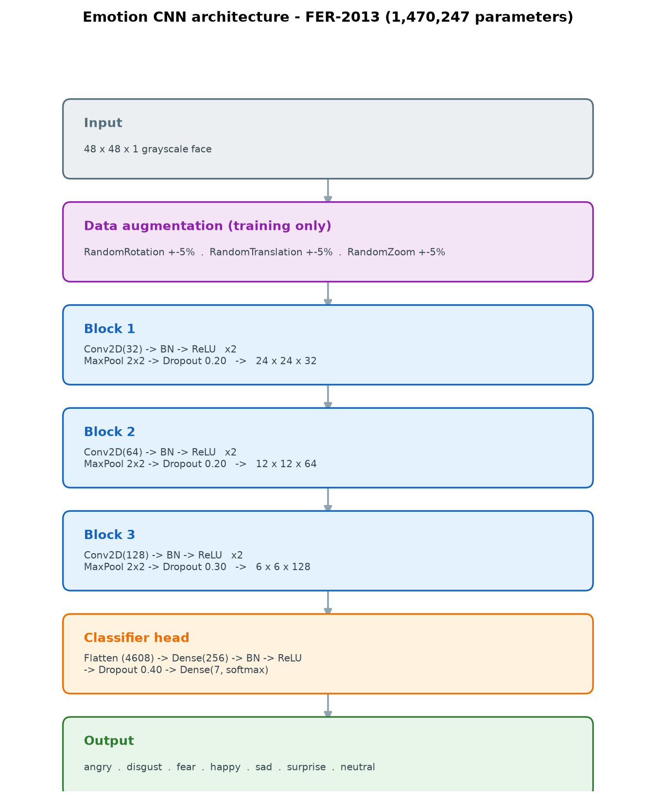
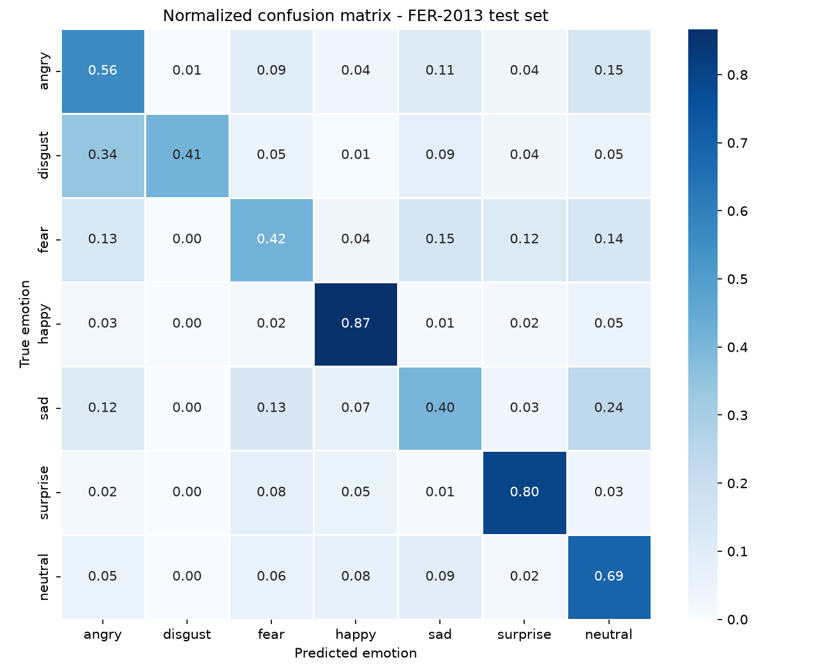
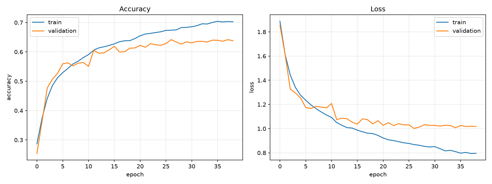

# Emotion Detection from Facial Expressions using Convolutional Neural Networks

**Dataset:** FER-2013 (`msambare/fer2013`, Kaggle)
**Task:** 7-class facial expression classification
**Model:** Convolutional Neural Network (CNN) — TensorFlow / Keras
**Final test accuracy:** **63.78 %**

---

## 1. Problem Statement

Understanding human emotions from facial expressions is valuable in areas such
as customer-feedback analysis, mental-health monitoring, and human–computer
interaction. Manual analysis is subjective and does not scale. There is a need
for an automated system that classifies human emotions directly from facial
images.

## 2. Proposed Solution

A Convolutional Neural Network is trained on the **FER-2013** dataset, which
contains grayscale facial images labelled with seven emotions (*angry, disgust,
fear, happy, sad, surprise, neutral*). The CNN learns hierarchical facial
features through stacked convolutional and max-pooling layers, followed by
dense layers that classify the input face into one of the seven categories.
The model is evaluated using **accuracy**, **per-class precision/recall/F1**
and a **confusion matrix** to analyse per-class performance. A lightweight face
detector (OpenCV DNN SSD) is combined with the classifier for real-world images
and webcam input.

## 3. Dataset

| Property | Value |
|---|---|
| Name | FER-2013 (Facial Expression Recognition 2013) |
| Source URL | https://www.kaggle.com/datasets/msambare/fer2013 |
| Original benchmark | Goodfellow et al., ICML 2013 Workshop |
| Images | 35,887 grayscale, 48 × 48 px, faces roughly centred |
| Classes | 7 |
| Training set | 28,709 |
| Test set | 7,178 (PublicTest 3,589 + PrivateTest 3,589) |

**Classes:** angry, disgust, fear, happy, sad, surprise, neutral.

**Training-set class distribution:** angry 3,995 · disgust 436 · fear 4,097 ·
happy 7,215 · sad 4,830 · surprise 3,171 · neutral 4,965.

The dataset is strongly imbalanced (disgust ≈ 1.5 % vs happy ≈ 25 %), which is
reflected in the per-class results and is handled with class weights (Section
4.5).

## 4. Data Preparation

### 4.1 Data cleaning
- The canonical distribution is a single labelled CSV
  (`icml_face_data.csv`, columns `emotion, Usage, pixels`) or the msambare-style
  `train/<class>` and `test/<class>` PNG folders. This project supports both
  (`src/dataset.py`).
- Rows with fewer than three fields are skipped; the pixel string is parsed and
  reshaped to `48 × 48`. No missing or corrupt images were found, so no image
  deletion was required. Corrupt/unreadable files encountered during export are
  detected when regenerating the folders with `scripts/prepare_data.py`.

### 4.2 Preprocessing & normalization
- Pixels are converted to `float32` and **normalised to `[0, 1]`** by dividing
  by 255 (`src/dataset.py`).
- Images are reshaped to `(48, 48, 1)` (single grayscale channel).
- At inference (`src/predict.py`) the same pipeline is used: BGR→grayscale,
  resize to 48 × 48, `/255`, reshape to `(1, 48, 48, 1)`.

### 4.3 Data augmentation
Light geometric jitter is applied **on-the-fly inside the model** (so it is
active only during training): rotation ±5 %, translation ±5 %, zoom ±5 %.
Horizontal flipping was deliberately **not** used because facial expressions
are asymmetric (e.g. disgust).

### 4.4 Class balancing
FER-2013 is imbalanced (Section 3), so the training uses **class weights**
(`compute_class_weights`, `src/dataset.py`), computed as
`w_i = N / (K · n_i)` where `n_i` is the number of samples in class *i*,
*K* = 7 classes and *N* the total. Minority classes (e.g. disgust ≈ 436) thus
receive a higher weight, the majority class (happy) a lower one. Augmentation
(Section 4.3) provides an additional, implicit form of minority-class
enlargement.

### 4.5 Train / validation / test split & leakage prevention
- The **test set is kept completely separate** and is used only for final
  evaluation.
- A **10 % validation split** is carved out of the training set with a fixed
  shuffled permutation (`np.random.default_rng(RANDOM_SEED)`) in `src/train.py`.
- **No data leakage:** validation indices are taken *after* shuffling the
  training data and are removed from the training pool (`X_tr`, `X_val` are
  disjoint); the test set is never used for model selection. Because the actual
  FER-2013 images are unique faces, a random split does not duplicate the same
  face across splits.
- Model selection uses only `val_accuracy` (checkpoint + early stopping); the
  test set is touched exactly once, after training.

## 5. Model

### 5.1 Architecture



```
Input (48×48×1)
 └─ Augmentation (rotation / translation / zoom)
 Block 1 : Conv2D(32) → BN → ReLU → Conv2D(32) → BN → ReLU → MaxPool → Dropout(0.2)
 Block 2 : Conv2D(64) → BN → ReLU → Conv2D(64) → BN → ReLU → MaxPool → Dropout(0.2)
 Block 3 : Conv2D(128) → BN → ReLU → Conv2D(128) → BN → ReLU → MaxPool → Dropout(0.3)
 Head    : Flatten → Dense(256) → BN → ReLU → Dropout(0.4) → Dense(7, softmax)
```

- **Parameters:** 1,470,247

### 5.2 Layer explanation
- **Conv2D (3×3, same padding):** learns local edge/texture/feature detectors.
  Filters grow 32 → 64 → 128 across blocks; two convolutions per block increase
  the receptive field and non-linearity.
- **Batch Normalization (BN):** after every convolution, stabilises activations
  and speeds up convergence; also has a mild regularising effect.
- **ReLU:** non-linear activation.
- **MaxPooling 2×2:** downsamples 48→24→12→6, giving translation tolerance and
  reducing computation.
- **Dropout (0.2 / 0.2 / 0.3 / 0.4):** regularisation to reduce overfitting;
  the rate increases toward the dense layers where most parameters live.
- **Flatten:** converts the 6×6×128 feature map to a 4,608-vector.
- **Dense(256) + BN + ReLU + Dropout(0.4):** fully-connected classifier body.
- **Dense(7, softmax):** output layer producing a probability per emotion.

### 5.3 Model selection rationale & baseline / alternative comparison

**Why this architecture:** a compact VGG-style CNN is a proven strong performer
on FER-2013-style 48×48 faces while remaining trainable **from scratch on
CPU**. Batch norm + dropout + augmentation give good regularisation without a
huge parameter budget, and the whole model trains in ~40 minutes on the target
laptop (Section 6). The architecture is intentionally small (~1.5 M parameters)
so it can be re-trained and explained during evaluation.

**Alternatives considered:**

| Approach | Test accuracy | Notes |
|---|---|---|
| Uniform random guessing (7 classes) | 14.29 % | trivial baseline (1/7) |
| Majority class (always "happy") | 24.71 % | trivial baseline (1774/7178) |
| HOG features + linear SVM | ≈ 35–40 % | classical pipeline (reported in literature) |
| **Our CNN (trained from scratch, CPU)** | **63.78 %** | this project |
| Larger / ensemble CNNs | ≈ 70–73 % | reported in literature |
| Transfer learning (VGG-Face / ResNet) | ≈ 70 %+ | requires GPU + pretrained weights |

The chosen model beats both trivial baselines by a wide margin (+39 points over
the majority class) and reaches the range typical of from-scratch CNNs on
FER-2013. Transfer learning and ensembles were deferred because they need a GPU
and pretrained weights (see Limitations).

### 5.4 Hyperparameters

| Hyper-parameter | Value |
|---|---|
| Input size | 48 × 48 × 1 |
| Batch size | 128 |
| Epochs (upper bound) | 100 (early stopping usually ends sooner — ran 39) |
| Optimizer | Adam |
| Learning rate | 1 × 10⁻³ with `ReduceLROnPlateau` (factor 0.5, patience 4, min 1e-6) |
| Loss | sparse categorical cross-entropy |
| Callbacks | EarlyStopping (patience 12), ModelCheckpoint (best `val_accuracy`), CSVLogger, wall-clock `TimeStopping` |

## 6. Training Setup (Hardware & Software)

| Item | Value |
|---|---|
| CPU | Intel® Core™ Ultra 7 155H, 16 cores / 22 threads |
| RAM | 15.5 GB |
| GPU | Intel® Arc™ integrated (not used — training is CPU-only) |
| OS | Windows 11 Home (10.0.26200) |
| Python | 3.13.2 |
| Framework | TensorFlow 2.21.0 / Keras 3.15.1 (oneDNN enabled) |
| Other libraries | NumPy 2.5.3, OpenCV 5.0.0, scikit-learn 1.9.1, Matplotlib 3.11.2, Seaborn 0.13.2, Flask 3.1.3 |
| Training time | ~40 min (39 epochs, batch 128, CPU) |

Full dependency pins are in `requirements.txt`.

## 7. Results

### 7.1 Overall accuracy

| Split | Accuracy |
|---|---|
| Validation (best) | 64.18 % |
| **Test (7,178 images)** | **63.78 %** |

### 7.2 Per-class performance (test set)

| Emotion | Precision | Recall | F1-score | Support |
|---|---|---|---|---|
| angry | 0.5504 | 0.5647 | 0.5574 | 958 |
| disgust | 0.7302 | 0.4144 | 0.5287 | 111 |
| fear | 0.4892 | 0.4189 | 0.4513 | 1024 |
| happy | 0.8350 | 0.8670 | **0.8507** | 1774 |
| sad | 0.5465 | 0.4050 | 0.4652 | 1247 |
| surprise | 0.7135 | 0.8002 | 0.7544 | 831 |
| neutral | 0.5485 | 0.6926 | 0.6122 | 1233 |
| **accuracy** | | | **0.6378** | 7178 |
| macro avg | 0.6305 | 0.5947 | 0.6029 | 7178 |
| weighted avg | 0.6327 | 0.6378 | 0.6305 | 7178 |

Task-specific metrics: **accuracy** (balanced headline number), plus
**precision / recall / F1** per class and **macro/weighted averages** to expose
the effect of class imbalance — exactly the right toolkit for a multi-class
classification task.

### 7.3 Confusion matrix (rows = true, columns = predicted)

```
             angry disgust  fear happy  sad surprise neutral
 angry   [   541     6     91    39   106    34     141  ]
 disgust [    38    46      6     1    10     4       6  ]
 fear    [   133     4    429    38   156   121     143  ]
 happy   [    46     0     40  1538    25    37      88  ]
 sad     [   145     4    168    86   505    41     298  ]
 surprise[    17     2     67    44     9   665      27  ]
 neutral [    63     1     76    96   113    30     854  ]
```



### 7.4 Training / validation curves



Accuracy and loss for train vs. validation over 39 epochs are in
`results/training_curves.png` (data in `results/history.json`), showing the
regularising effect of augmentation/dropout and the learning-rate drops.

## 8. Error Analysis

### 8.1 Where the model fails (from the confusion matrix)
- **Fear ⇄ sad ⇄ neutral** are the main confusions: fear is misread as neutral
  (143) or angry (133); sad is misread as neutral (298) or fear (168); neutral
  is misread as sad (113) or happy (96). These share subtle, low-contrast brow
  and mouth cues.
- **Disgust** has high precision (0.73) but low recall (0.41) — when predicted
  it is usually right, but it is often missed because only 436 training images
  exist.
- **Happy (F1 0.85)** and **surprise (F1 0.75)** are the easiest — distinctive
  high-contrast cues (smile; open mouth / raised brows).

### 8.2 Concrete prediction examples (real model output)
Run `scripts/make_output_examples.py` to reproduce; full text in
`results/prediction_output_examples.txt`, annotated images in
`results/output_examples/`.

| Example | True | Predicted | Confidence | Comment |
|---|---|---|---|---|
| `sample_happy.png` | happy | happy | 99.58 % | very confident, correct |
| `sample_surprise.png` | surprise | surprise | 67.28 % | correct |
| `sample_fear.png` | fear | fear | 45.46 % | correct but low confidence (sad = 36 %) |
| `sample_angry.png` | angry | angry | 41.18 % | correct, fear close behind (25 %) |
| `sample_neutral.png` | neutral | **fear** | 38.16 % | error: neutral read as fear |
| `sample_sad.png` | sad | **angry** | 77.11 % | error: sad read as angry |
| `sample_disgust.png` | disgust | **surprise** | 30.51 % | error: ambiguous (disgust 24 %, happy 24 %) |

On these seven examples the model is correct 5/7; the two errors are
neutral→fear and sad→angry, consistent with the confusion-matrix findings. Note
the model can be **confidently wrong** (sad→angry at 77 %), so confidence alone
is not a reliable correctness signal.

### 8.3 Takeaways
- Errors concentrate between visually similar, low-arousal classes.
- The minority class (disgust) suffers most from limited data.
- Improving confidence calibration, and adding more disgust/sad/neutral data or
  a focal loss, are the natural next steps.

## 9. Applications
Customer sentiment analysis, interactive/affective systems, driver-monitoring,
and mental-health monitoring tools.

## 10. Limitations & Future Work
- CPU-only training; a GPU and/or transfer learning (pre-trained face models)
  would push accuracy toward 70 %+.
- Small, imbalanced classes (disgust) limit per-class performance; oversampling
  or focal loss could help.
- FER-2013 images are pre-cropped; real-world use combines the model with the
  shipped face detector (`src/face_detector.py`), which adds its own errors on
  off-angle faces.
- Reported accuracies for larger/ensembled models are literature values and can
  vary with exact splits.

## 11. Reproducibility

- **Random seeds:** Python `random`, NumPy and TensorFlow seeds are fixed to
  42 (`src/utils.set_seed`), and the validation split uses a seeded RNG. TensorFlow
  on CPU with oneDNN may still show tiny numerical differences run-to-run.
- **Artifacts:** the trained model is saved as `models/emotion_cnn_fer2013.keras`
  (with an `.h5` copy), and all metrics/figures are regenerated by
  `src/evaluate.py`.
- **Step-by-step:** see `README.md` and Section 12 below.

## 12. How to Reproduce

```powershell
python scripts\prepare_data.py      # verify dataset + build folders
python -m src.train                 # train the CNN
python -m src.evaluate              # accuracy + confusion matrix
python -m src.predict --image data\samples\sample_happy.png
python scripts\make_output_examples.py   # regenerate output examples
python webapp\app.py                # web demo
```

## 13. Conclusion
A CNN trained from scratch on FER-2013 reaches **63.78 % test accuracy**,
comfortably above the ~25 % majority-class baseline (~48 points above random
guessing at 14.3 %), and demonstrates the core techniques of deep learning for
affective computing: convolutional feature extraction, regularisation
(BN / dropout / augmentation), class-weighted learning for imbalanced data,
learning-rate scheduling, and rigorous evaluation via accuracy, per-class
metrics and a confusion matrix.

## 14. References
1. Goodfellow et al. (2013). *Challenges in Representation Learning: A report
   on three machine learning contests (FER-2013).* ICML Workshop.
2. Kaggle FER-2013 dataset — `msambare/fer2013`
   (https://www.kaggle.com/datasets/msambare/fer2013).
3. TensorFlow / Keras documentation.
4. Scikit-learn user guide (metrics)
5. OpenCV DNN face detector samples
   (https://github.com/opencv/opencv/tree/master/samples/dnn/face_detector).

See also `docs/DECLARATION.md` for the declaration of originality and
acknowledgements, and `docs/checklist.md` for the requirement-to-evidence map.
